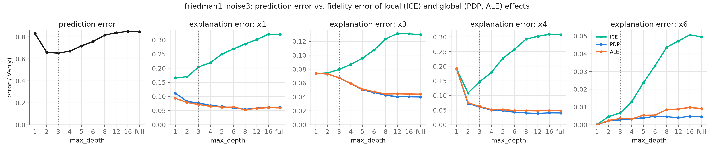
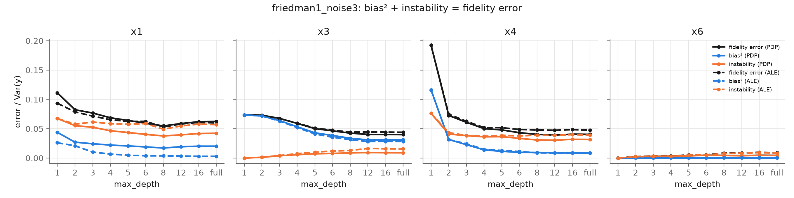

# iML 26/27 – Exercise 2: Feature Effects from Underfit to Overfit

**Research question.** *How does the degree of model fit affect the stability and fidelity of feature effect explanations?*

## Summary

All statements below are about this experiment: decision trees trained on 200 points, explanations computed on a fixed reference set and grid, and (for fidelity) the synthetic Friedman #1 problem. They are empirical findings under these conditions, not general laws.

**Hypotheses** (fixed before running the experiment):

- **H1.** The fidelity error of an explanation is U-shaped in model complexity: bias dominates when the model underfits, instability when it overfits.
- **H2.** Explanations of underfit models are stable but biased.
- **H3.** With correlated features, overfitting degrades PDP more than ALE, because PDP evaluates the model in low-density regions where an overfit model is least constrained.

**Findings:**

1. **H1 holds for mean ICE error, but not for PDP or ALE.** From the depth with the best test $R^2$ (3) to the fully grown tree on `friedman1_noise3`, the prediction error $1 - R^2_{test}$ rises from 0.65 to 0.85, and so does the ICE fidelity error (0.14 → 0.25, mean over the relevant features $x_1, x_3, x_4$).
   Over the same range the mean fidelity error of PDP *falls* (0.068 → 0.048), and so does that of ALE (0.067 → 0.050). The decrease is not monotone for every feature: for $x_1$ the PDP error is lowest at depth 8 (0.055) and rises again to 0.062 at full depth.
2. **H2 holds only partly.** The underfit trees are biased, but whether they are also stable depends on the feature. A feature they never split on ($x_3$ at depth 1) gets a flat, perfectly stable and entirely wrong curve. Features that compete for the few splits ($x_1$, $x_4$) get the *most* unstable PDPs of all depths.
3. **H3 is not supported.** Averaged over the refits, the PDP and the ALE of the trees nearly agree (distance between the mean curves ≈ 0.001 at all depths), while those of the *true function* differ (0.027). Single trees do disagree, increasingly with depth ($x_1$: 0.003 at depth 3, 0.013 at full depth), but the differences change direction between refits and cancel on average. PDP therefore keeps a persistent error against its own target for $x_1$ (bias² ≈ 0.02 at every depth ≥ 3), while ALE gets close to its own target (0.003). The two errors are measured against different targets, so this does not mean ALE is better in general.
4. **ALE is less stable than PDP.** At full depth, ALE instability is higher than PDP instability for every explained feature on all three datasets, by a factor of 1.2 to 2.7.



## Reproduce

```bash
uv sync --extra dev
uv run pytest
uv run python scripts/run_experiment.py            # all datasets, 30 refits, ~30 s -> results/<dataset>/
uv run python scripts/run_experiment.py --datasets friedman1_noise3 --n-reps 5   # quick check -> results/quick/
```

The first run downloads Concrete from OpenML (data id 44959) into `data/`. Everything is seeded (master seed 0) and deterministic. A run with a number of refits other than 30 writes to `results/quick/` (or to `--out`), so it never overwrites the full results. [`figures/`](figures/) holds the two figures shown in this README, copied from `results/friedman1_noise3/` (`decoupling.png`, `metrics.png`) after a full run, because `results/` is not committed.

## Setup

### Datasets

| Dataset | Rows | Role | Why it is interesting |
|---|---|---|---|
| `friedman1`: Friedman #1 with correlated features, $\sigma = 1$ | generated | ground truth → stability **and** fidelity | known function with an interaction, a quadratic, a linear and irrelevant features |
| `friedman1_noise3`: same, $\sigma = 3$ | generated | as above, main setting | with more noise, deep trees clearly overfit in test $R^2$ |
| `concrete`: Concrete Compressive Strength (Yeh, 1998) | 1005 after deduplication | real data → stability only | strongly non-linear `age` effect; `water` and `superplasticizer` are correlated (Spearman −0.69) |

**Friedman #1.** $y = 10\sin(\pi x_1 x_2) + 20(x_3 - 0.5)^2 + 10x_4 + 5x_5 + \varepsilon$ with $\varepsilon \sim \mathcal{N}(0, \sigma^2)$ and ten features with $U(0,1)$ marginals, of which $x_6, \dots, x_{10}$ are irrelevant. I added dependence with a Gaussian copula ($z \sim \mathcal{N}(0, \Sigma)$, $x_j = \Phi(z_j)$):

- $x_1$–$x_2$ with $\rho = 0.8$: they interact *and* are correlated, so PDP evaluates the model at combinations of low density. For example, $P(x_1 > 0.8,\ x_2 < 0.2) \approx 0.0003$ (0.04 under independence), i.e. about 0.06 of the 200 training points are expected there. The copula has full support, so such points are rare, not impossible.
- $x_4$–$x_6$ with $\rho = 0.8$: $x_6$ has no effect but is correlated with $x_4$, so a model may attribute part of the $x_4$ effect to it.

Without correlation PDP and ALE coincide, so the comparison would be uninformative. Explained features: $x_1$ (interaction + correlation), $x_3$ (quadratic), $x_4$ (linear), $x_6$ (irrelevant).

**Concrete.** The target is compressive strength (MPa). The same mixture of the seven ingredients is often measured at several ages, so the test set is split off **by mixture** (`GroupShuffleSplit`, 428 mixtures); otherwise a model would be tested on mixtures it has already seen at another age. Exact duplicate rows are removed. Explained features: `age`, `cement`, `water`, `superplasticizer`.

### Settings

| | Friedman #1 | Concrete |
|---|---|---|
| training set per refit | 200 fresh draws from the generator | 200 rows drawn without replacement from a pool of 698 |
| test set (fixed) | 2000 draws | 307 rows (30% of the mixtures) |
| reference data for effects (fixed) | 1000 draws | the test set |
| refits per depth | 30 | 30 |
| grid per feature | 30 unique quantiles of the reference data | at most 30: `age` 12, `cement` 30, `water` 24, `superplasticizer` 18 points (merged duplicate quantiles) |
| ICE | first 200 reference points | – |
| seed | 0 for test/reference data, $r$ for refit $r$ | 0 for the split, $r$ for refit $r$ |

### Models

Decision trees (`DecisionTreeRegressor`, `min_samples_leaf=1`) with `max_depth` $\in \{1, 2, 3, 4, 5, 6, 8, 12, 16, \text{None}\}$. I varied max_depth while keeping the training size and other tree parameters fixed; trees are fast enough for 30 refits per level; and a fully grown tree (nearly) interpolates its training data. Fully grown trees reach depth ≈ 15 here (they are unbalanced), so depth 16 and `None` are nearly identical; the fitted depth and number of leaves are recorded in `fits.csv`.

Why each level is under-, well or overfit (mean over 30 refits, depth 16 omitted; full figures in `results/*/fit.png`):

| `max_depth` | 1 | 2 | 3 | 4 | 5 | 6 | 8 | 12 | full |
|---|---|---|---|---|---|---|---|---|---|
| leaves (`friedman1_noise3`) | 2 | 4 | 8 | 16 | 30 | 51 | 107 | 184 | 200 |
| `friedman1_noise3` train / test $R^2$ | .26 / .17 | .46 / .34 | .59 / **.35** | .71 / .33 | .81 / .28 | .88 / .24 | .96 / .18 | 1.00 / .16 | 1.00 / .15 |
| `friedman1` train / test $R^2$ | .32 / .23 | .57 / .47 | .69 / .51 | .79 / .54 | .87 / **.54** | .93 / .54 | .98 / .53 | 1.00 / .52 | 1.00 / .53 |
| `concrete` train / test $R^2$ | .26 / .17 | .52 / .34 | .67 / .48 | .79 / .53 | .87 / .57 | .93 / .58 | .98 / .58 | 1.00 / .59 | 1.00 / .59 |

- **Underfit** (depth 1–2, for `friedman1` and `concrete` up to 3): train and test $R^2$ are both low and still rising with capacity; a depth-1 tree has a single split.
- **Well fit**: the depth with the best test $R^2$ (3 for `friedman1_noise3`, 4–6 for `friedman1`, ≥ 5 for `concrete`).
- **Overfit** (depth ≥ 8): about one leaf per training point and train $R^2 \approx 1$, i.e. the trees memorize their training sets. For `friedman1_noise3`, test $R^2$ falls to less than half of its maximum. For `friedman1` it declines only slightly, and for `concrete` not at all; there the deep trees *nearly* interpolate (train $R^2$ = 0.998, because some identical inputs have different targets) without losing test performance. Concrete therefore shows the near-interpolating regime, not overfitting in the sense of a rising test error.

### Explanations

All implemented in [`effects.py`](iml_feature_effects/effects.py) on a given grid:

- **PDP**: mean prediction over the reference data with the feature set to the grid value.
- **ALE** (Apley & Zhu): accumulated mean prediction differences, each point moved only within its own grid interval. Intervals without reference points contribute no change by convention, which does not mean that the effect is flat there; this happens for one of the 29 intervals of `cement`.
- **ICE**: per-instance curves whose mean is the PDP; a *local* explanation.

Every curve is centered on its unweighted mean over the grid (each ICE curve on its own mean), so only the shape is compared. For continuous features with a quantile grid this is close to centering by the feature's distribution; for features with merged quantiles (`age`, `water`, `superplasticizer`) grid points are not weighted by frequency. The same centering is used for all methods, otherwise different default centerings of PDP and ALE would look like disagreement. All effects are effects of a *function* (the fitted model or the true regression function), not causal effects of the feature.

### Metrics

For one feature and method, let $g_1, \dots, g_R$ be the curves of the $R = 30$ refits, $\bar g$ their mean, and $g^*$ the curve the *same estimator* gives for the true function: the same method, reference data and grid (so PDP is compared with the PDP of $f$ and ALE with the ALE of $f$). With $\|h\|^2$ the unweighted mean of $h^2$ over the grid:

$$
\underbrace{\frac{1}{R}\sum_{r}\|g_r - g^*\|^2}_{\text{fidelity error}}
= \underbrace{\|\bar g - g^*\|^2}_{\text{bias}^2}
+ \underbrace{\frac{1}{R}\sum_{r}\|g_r - \bar g\|^2}_{\text{instability}}
$$

This is an **empirical** decomposition on a fixed reference set, grid and number of refits: $g^*$ is a reference curve, not the population effect, and $\|\bar g - g^*\|^2$ still contains the Monte Carlo error of $\bar g$ (in expectation, instability / $R$, i.e. about 3% of the instability).

All three are divided by the variance of the test target (`ddof=0`, the same normalization as in $1 - R^2_{test}$), so they are comparable across features (also for $x_6$, whose true effect is zero) and with the prediction error. A value of 0.04 means the curve is off by about $\sqrt{0.04} = 0.2$ standard deviations of $y$. Fidelity needs ground truth and is only computed for Friedman; instability is computed for all datasets. `disagreement.csv` holds two distances between PDP and ALE per depth: `pdp_vs_ale` between the *mean* curves (systematic disagreement; differences that change sign between refits cancel) and `pdp_vs_ale_per_refit`, the distance between the two curves of the *same* refit, averaged over refits (the disagreement a user of one fitted model sees; never smaller than the first). For ICE, `ice_metrics.csv` also contains the PDP computed from the *same* 200 points (method `pdp_ice_points`) for a like-for-like comparison.

## Results

Numbers are for `friedman1_noise3` unless stated otherwise.

**1. Prediction error and global explanation error move in opposite directions under overfitting; local explanation error does not.** From depth 3 (best test $R^2$) to full depth:

| | depth 3 | full |
|---|---|---|
| prediction error $1 - R^2_{test}$ | 0.65 | 0.85 |
| ICE fidelity error (mean over $x_1, x_3, x_4$) | 0.14 | 0.25 |
| PDP on the same 200 points | 0.068 | 0.048 |
| PDP on all 1000 reference points | 0.068 | 0.048 |
| ALE | 0.067 | 0.050 |

Per feature, the PDP error falls from 0.077 to 0.062 ($x_1$), from 0.068 to 0.040 ($x_3$) and from 0.061 to 0.040 ($x_4$), but not monotonically: for $x_1$ it is lowest at depth 8 (0.055). On `friedman1` ($\sigma = 1$) the pattern is the same but weaker: from the best depth (5) to full depth, prediction error rises from 0.46 to 0.47, ICE error from 0.17 to 0.20, and PDP error falls from 0.062 to 0.053. The ICE increase comes almost entirely from instability ($x_4$: 0.12 → 0.29).

Two remarks on interpretation:

- That PDP has a smaller error than ICE at *every* depth is not a finding: the PDP is the mean of the ICE curves, so by Jensen's inequality its error can never be larger. The finding is the opposite *trend*. Computing PDP from the same 200 points as ICE gives the same trend, so it is not caused by the larger reference set.
- **A plausible explanation, not tested here:** a deep tree fits the noise of its training sample, which makes individual predictions (and ICE curves) vary strongly between refits, but these deviations partly cancel when PDP or ALE averages over many reference points. The deviations are not independent zero-mean noise (the splits themselves are chosen on noisy labels, and many reference points share a leaf), so this experiment does not isolate the mechanism.

**2. Underfitting: bias for features that are not used, instability for features that compete for splits.** A depth-1 tree never splits on $x_3$: its PDP is flat, instability is 0, and the whole error (0.074) is bias. The depth-1 PDPs of $x_1$ and $x_4$ have their highest instability (0.067 and 0.076) because which feature receives the single split changes with the sample; the depth-1 PDP error of $x_4$ (0.19) is almost five times that of the full tree (0.040). Not every explanation of an underfit model is worse, though: the irrelevant $x_6$ trivially gets the correct zero effect at depth 1, and ICE curves of depth-1 and depth-2 trees are *closer* to the truth than those of fully grown trees.

**3. Correlated, interacting features: a persistent PDP error that does not depend on the fit.** For $x_1$, the PDP keeps a bias² of about 0.02 at every depth ≥ 3, while the ALE falls to 0.003. Averaged over the refits, PDP and ALE of the trees nearly agree (distance of the mean curves ≈ 0.001), but those of the true function differ (0.027): the true PDP of $x_1$ depends on $f$ in low-density combinations (large $x_1$, small $x_2$) that the 200 training points hardly cover. A *single* tree's PDP and ALE differ more, and more so the deeper the tree (0.003 at depth 3, 0.013 at full depth), but in directions that vary between refits. This is consistent with the low density being the reason, but the experiment has no uncorrelated control, so the cause is not isolated; the residual error may also come from the training size, the piecewise-constant trees and the finite reference sample.

**4. ALE is less stable than PDP.** At full depth, ALE instability exceeds PDP instability for every explained feature, e.g. $x_1$ (0.057 vs. 0.042), `cement` (0.099 vs. 0.037), `superplasticizer` (0.017 vs. 0.007) and `age` (0.029 vs. 0.013). ALE averages local differences over the few points inside each grid interval; on Concrete a single refit can jump by about 15 MPa in the sparsely populated high-dose region of `superplasticizer` (37% of the rows contain none).

**5. Concrete: stability over depth differs between methods and features.** PDP instability falls with depth for `age` (0.066 → 0.013) and `cement` (0.085 → 0.037) and stays at about 0.025 for `water`. ALE instability also falls for `age` (0.066 → 0.029) but rises for `cement` (0.085 → 0.099) and `superplasticizer` (0 → 0.017). The distance between the PDP and the ALE of the same refit grows with depth from 0 to 0.02–0.07 at full depth (`age` 0.020, `cement` 0.068, `water` 0.042, `superplasticizer` 0.018), while the distance between the mean curves stays at 0.001–0.008.

**6. Irrelevant features.** The true effect of $x_6$ is zero. The mean PDP stays close to zero (fidelity error ≤ 0.005 at every depth), while single ICE curves of fully grown trees show spurious effects (ICE fidelity error 0.05).



## What this means in practice

- **Underfit model:** effects of features the model hardly uses are missing (here $x_3$ looks irrelevant), and which feature appears to matter can depend on the sample. Treat its explanations with suspicion even when they look stable.
- **Overfit model, global effects (PDP, ALE):** here a poor test score caused by overfitting did not make the *average* curve worse. Read the overall shape rather than single bumps or the ends of the range, where single refits deviate most, and check stability by refitting if possible.
- **Overfit model, local effects (ICE):** individual curves vary strongly between refits and can show effects of irrelevant features. Check ICE variability across refits before interpreting instance-level effects.
- **Correlated features:** PDP depends on predictions in low-density regions. PDP and ALE answer different questions; choose accordingly and check stability by refitting.
- **For one complex model, PDP and ALE can disagree noticeably** even where they agree on average over refits; looking at both shows how much a conclusion depends on the method.
- **The best predictor is not necessarily the model with the most faithful global explanation.**

## Limitations

- One model class. Trees predict a constant beyond the data; models that extrapolate wildly (MLPs, polynomials) may behave differently in low-density regions.
- One training size ($n = 200$), one grid resolution, and errors averaged with equal weight over the grid.
- The averaging explanation of finding 1 and the low-density explanation of finding 3 are hypotheses: no experiment isolates them (e.g. an uncorrelated control or a direct decomposition of leaf noise).
- The decomposition is empirical: finite reference sets, finite grids, 30 refits; bias² includes a small Monte Carlo term.
- Concrete has no ground truth, so only stability is measured there. Two subsamples of the 698-row pool share on average 29% of their rows, so its instability is somewhat underestimated. Its ALE uses only 307 reference points (Friedman: 1000), which inflates ALE variance compared with Friedman.
- ICE compares centered curves (shape, not level) on 200 reference points.

## Repository structure

```
iml_feature_effects/
├── data.py        # CorrelatedFriedman1, load_concrete(), SyntheticTask / SubsampleTask (repeated sampling)
├── models.py      # get_models(): decision trees for each max_depth
├── effects.py     # PartialDependence, AccumulatedLocalEffects, ice_curves, FunctionModel (true function)
├── metrics.py     # instability, bias_squared, fidelity_error, curve_distance
├── evaluate.py    # run_repetitions(), summarize(), method_disagreement(), ice_fidelity()
└── plotting.py    # all figures
scripts/run_experiment.py   # runs everything, writes results/<dataset>/
tests/test_smoke.py         # offline tests (known functions, decomposition, sampling, edge cases, pipeline)
figures/                    # selected figures for this README
presentation/               # presentation.pdf
```

Code style is checked with `ruff check` and `ruff format` (configuration in `pyproject.toml`).

## AI statement

I used two AI tools for this exercise.

Claude (Anthropic, model Claude Opus 5.5)

- Design discusssions.
- Partial implementation in `iml_feature_effects/` and `scripts/run_experiment.py`. All have been manually reviewed.

ChatGPT/Codex (OpenAI, model GPT-6.1 Sol)

- Reviewed the repo against the assignment requirements and checked the mathematical definitions and experimental design.
- Review the README and presentation text and polished the language.
- Helped draft this statement.

I personally reviewed all code and materials and ran the complete experimental pipeline locally to verify reproducibility.